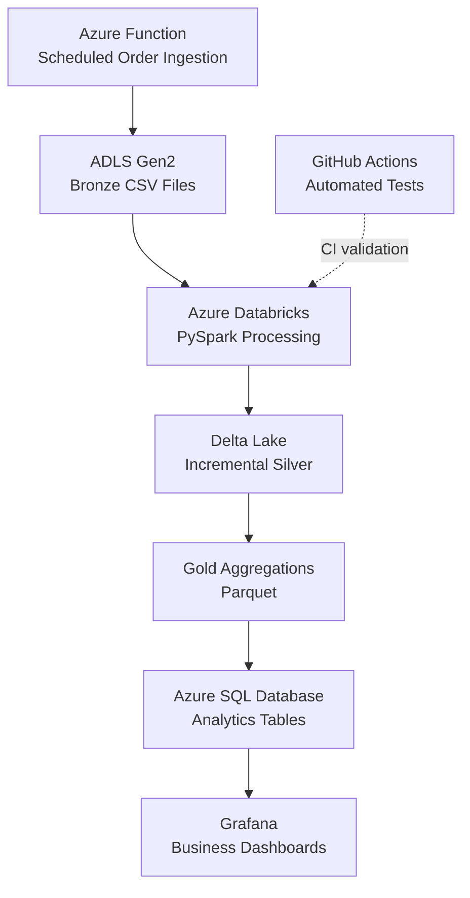

# Retail Intelligence & Supply Chain Risk Platform

An end-to-end data engineering project that transforms retail order data into analytics-ready datasets and business insights using Azure cloud services, Databricks, PySpark, Delta Lake, Azure SQL, and Grafana.

## Project Overview

This platform simulates a retail data pipeline that ingests order data, processes it incrementally, validates data quality, generates analytical datasets, and presents key performance indicators through dashboards.

## Architecture

The pipeline separates raw ingestion, incremental processing, curated analytics, and visualization. GitHub Actions independently validates the Python tests.

## Technology Stack

- **Cloud:** Microsoft Azure
- **Data Lake:** Azure Data Lake Storage Gen2
- **Data Processing:** Azure Databricks, PySpark
- **Storage Format:** Parquet, Delta Lake
- **Database:** Azure SQL Database
- **Orchestration:** Apache Airflow (planned)
- **Visualization:** Grafana
- **Programming:** Python, SQL

## Key Features

- Scheduled ingestion of synthetic retail orders.
- Bronze, Silver, and Gold data layers.
- Incremental file processing with a processed-file manifest.
- Idempotent Delta Lake MERGE operations using order IDs.
- Data-quality checks for missing IDs, duplicate orders, invalid prices, quantities, and dates.
- Aggregated sales and product performance metrics.
- Azure SQL serving tables for analytics.
- Grafana dashboards for retail KPIs.

## Business Metrics

- Total orders
- Net revenue
- Average order value
- Late delivery percentage
- Cancellation percentage
- Daily sales trends
- Product category performance

## Project Status

The Azure ingestion, Databricks processing, Azure SQL publishing, and Grafana dashboard have been implemented. Incremental processing and idempotency are being validated. Airflow orchestration, retries, failure alerts, automated tests, and Docker packaging are planned enhancements.

## Security

Credentials and secrets must be stored outside source control. Never commit Azure access keys, passwords, tokens, or real customer data.

## Future Enhancements

- Apache Airflow orchestration with retries and failure notifications.
- Unit tests and data-quality test automation.
- Docker-based local development.
- CI/CD integration.
- Improved pipeline monitoring and recovery.

## Author

Data Engineering Portfolio Project
